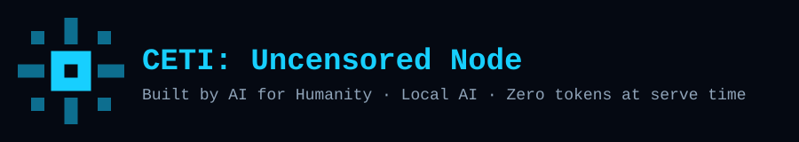
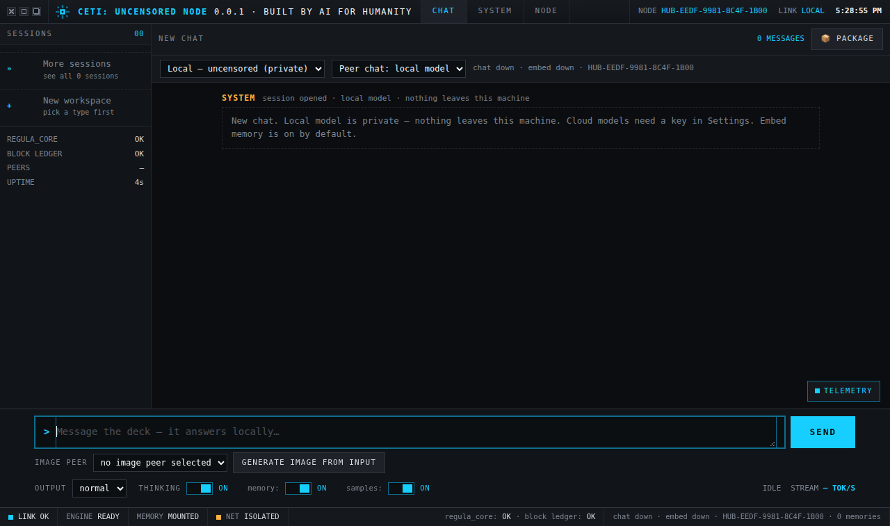
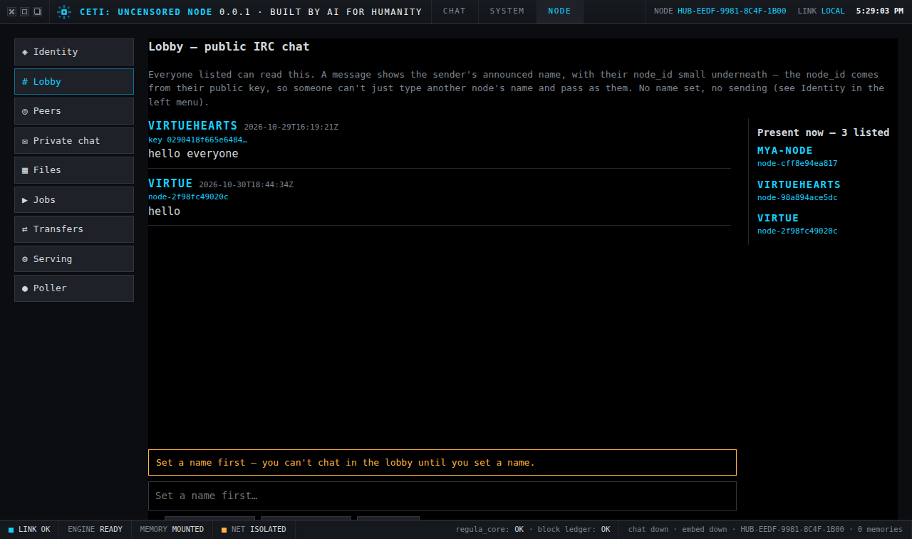

# CETI: Uncensored Node — Sovereign AI, run on your own iron

**Produced by [darknet.ca Labs](https://darknet.ca) — Toronto, Canada.**

CETI: Uncensored Node is a local-first AI network. Every node runs on its
operator's own hardware, holds its own keys, and keeps its own data.
No accounts, no cloud dashboards, no one else's model shaping your
answers. Chat, long-form stories and ezines, code, voice, and image —
served by uncensored models you control, shared node to node.

This is the project to make sovereign AI the Canadian hub: built in
Toronto, for anyone who wants their AI to live in their own building.

## What it is

- **Your node, your rules.** A node is a laptop, a desktop, a phone,
  or a box in your rack. It announces itself to the network and serves
  what its operator allows — nothing more.
- **Uncensored models, locally.** Chat runs on models from the
  Hugging Face Hub, fetched through the Hub's Models tab. The token
  is per-request only: never stored, never logged, never sent
  anywhere but the download itself.
- **No inbound ports, no firewall fights.** Nodes sit behind NAT and
  firewalls like everything else. They poll a mailbox on the list
  host, so serving works outbound-only — nothing inbound anywhere.
- **Everything signed.** Every node has one identity key
  (`identity.dat`, secp256k1, created on first run, never leaves the
  box). Announces, lobby posts, private chats, file offers, and
  ledger events are all signed and verified with that key. Nothing
  counts until it is signed.
- **Every write on the ledger.** Sessions, stories, ezines, code,
  samples, model downloads, and shared files are all recorded in the
  node's append-only regula ledger: signed, hash-chained events, so
  any output can be traced back to the data and the model behind it.

## CETI: the new version

Uncensored Node is now CETI: Uncensored Node — the node network as
the new version of CETI, the platform the new CETI is being built
on. The goal is unchanged from CETI's founding rule
and is now the project's headline: **zero tokens at serve time.**

- **Local AI.** Uncensored models plus local memory. Chat runs on
  models on your own iron; memory is the node's own identity-bound
  store, filtered by identity hash in every query, so one node's
  memories are never another's.
- **The AIML engine is the next build.** The embedded server gains
  CETI's local AIML retrieval tier: a question is answered from
  local patterns and local memory first, and the model runs only
  on a miss. Serving becomes retrieval; the model becomes a
  background compiler that writes new memory, not a meter that
  runs on every question.
- **The ledger is how compute stops being wasted.** Every write
  is already on the regula ledger, and content-addressed blocks
  mean identical bytes are never stored twice. The same rule
  extends to answers: work the network has already done, verified,
  and ledgered is served from memory instead of recomputed. No
  re-running a model for an answer the ledger already holds.
- **Same easy setup, everything kept.** Autorun, the web UI, the
  Node tab, Jobs, Transfers, Serving, Files, Memory — all of it
  carries over. The rename changes the name on the top bar, not
  the machine underneath it.

Footnote — this release does not use CETI AIML technology yet,
nor the CETI BIOS for general intelligence. CETI's technology was
used in developing this release: the node network is the platform
the new CETI is being built on, and the AIML engine and BIOS land
in a later build.

## The network: Gopher, not a platform

There is no central sysop, no approval queue, and no verified badge.
A valid announce lists the node immediately, with the capabilities it
claims to offer. The list host (`node.darknet.ca`) is a dumb pipe:
signature plus listed check, nothing more.

- **List** — nodes announce a name, a public key, capabilities
  (`text`, `tts`, `image`), and an optional endpoint. Anyone can read
  the list; nodes populate it by announcing.
- **Allow, deny, mute — per node, locally.** Each operator keeps a
  local allow-list that never leaves their node. Allow means a
  standing yes with no per-job ask; deny is an explicit error;
  block/mute is a silent drop. Unlisted nodes fall back to the
  allow set, otherwise they are silently skipped.
- **Lobby** — a public, IRC-like room: signed posts from listed
  nodes only, last 100 messages. Asking for access means talking to
  the operator here.
- **Private sysop chat** — a separate queue for operator-to-operator
  messages, kept apart from the job mailbox so the poller can never
  eat chat.
- **Favorites** — a per-node local list of nodes you trust.
- **Jobs** — text, voice, and image jobs travel through the mailbox:
  send, poll, reply, with retries and bounce-back instead of silent
  loss. At most once, fail loud, never silently empty.

## Sharing models via nodes

Models are files, and files are what the network moves best.

1. **Download** an uncensored model from the Hugging Face Hub in the
   Models tab. It lands in your `models/` folder, ready to run.
2. **It is chunked automatically** into 50MB signed blocks in your
   local block store (`data/blocks/`), content-addressed by hash —
   identical bytes are never stored twice — with a signed Merkle
   manifest and a ledger event closing the set.
3. **Publish it** as a public file offer from the Files tab. The
   offer carries the manifest: chunk list in order, whole-file
   sha256, Merkle root, ledger tip, signature.
4. **Peers fetch it chunk by chunk**, hash-verified at every step,
   over the node-to-node transfer path. A model you already
   downloaded can be shared with any node that is allowed to fetch
   it — no re-download from the Hub, no central mirror in the way.

Already-downloaded models are first-class shared files: if it is on
your disk, your node can offer it.

## Coming soon: our own hosting

Today, models come from the Hugging Face Hub. The next step is
darknet.ca's own hosting: a sovereign model registry and mirror run
by darknet.ca Labs, so nodes can fetch uncensored models without
depending on any third-party hub at all. The chunked block store and
signed manifests are already built for exactly that — the hosting
just changes where the first copy comes from.

## Quickstart (laptop)

1. Download `laptop-uncensored-node-0.0.1.zip` and unzip it.
2. Run `autorun.bat` (Windows) or `autorun.sh` (Linux). The Hub
   starts, checks its setup, and opens the web UI.
3. Open `http://localhost:8900` in your browser.
4. Set your node's name, announce to the list, and allow the peers
   you want to serve. Chat, Jobs, Models, Memory, and Files are all
   in the UI — the Node tab is the network.
5. Phone: the Android app ships separately as
   `android-uncensored-node-0.0.1.zip` — build it in Android
   Studio, then announce from the app.

Requirements: Python on the machine running the Hub; a model needs
disk space and RAM/VRAM to run (chat on VRAM, embeddings on CPU/RAM
by default so they don't steal VRAM). GPU memory figures in the
Models tab are labelled estimates (file size × 1.2), not
measurements.

## Screenshots

Chat, the default view:

Node tab, Lobby — the IRC room:

A self-contained copy of this README, images baked in for reading
offline or where relative links can't resolve, ships in `info/`
(`info/ceti-readme-baked.html`).

## The ledger (regula core)

`hub/regula.py` is the local file system based on the ledger:

- `data/ledger.json` — append-only chain of signed events, each
  carrying `prev_hash`, with the event hash covering the event plus
  its signature. Rejected items never enter signed history: a
  failed publish records no event.
- `data/blocks/` — 50MB content-addressed chunks plus one signed
  manifest per file. `GET /api/ledger/status` re-verifies the whole
  chain (hashes, prev-hash pointers, signatures); the Files tab
  shows ledger OK and height.
- The 2006 Chamber Zero header (RSA-1024, LCG nonce) is history,
  not the scheme used here. The scheme is the network's own:
  ECDSA secp256k1 over double-SHA256, DER.

## Dev blog: getting the nodes and the poller to talk

The concept is simple to say and stubborn to build: distributed
peer-to-peer AI. Not a platform you log into, but a network of
nodes — laptops, desktops, phones, boxes in racks — each running
its own models, holding its own keys, keeping its own data, and
serving the others. Knowledge, LLMs, image generation, and voice,
all in one node, all over the same signed, ledgered protocol.
Later: music, video, research, same rails. The network is the
computer, and no one operates it.

This is the part where the idea fought back.

**Nobody can listen.** Every machine that matters sits behind NAT
or a firewall, and none of them accept inbound connections. A node
cannot be a server in the usual sense, so it never tries. Instead
it polls: the poller opens an outbound connection to the list
host and asks, "anything for me?" Jobs arrive in a mailbox, the
node verifies the signature and its own allow-list, runs the job
against a local model, the voice bridge, or the image queue, and
posts a signed reply to the requester's mailbox. Serving works
outbound-only, past any firewall. The list host itself is a dumb
pipe — signature plus listed check, nothing more — because the
moment it starts deciding, it becomes the platform we are trying
not to build.

**The mailbox eats messages.** The mailbox is fetch-and-clear:
whoever polls first consumes. Early on, the serving poller ate
replies meant for the UI, and the UI's reply fetch ate jobs meant
for the poller. The fix is the bounce: a fetched message that is
not yours is re-queued verbatim, and the server re-verifies the
original signature on post, so a forged message cannot bounce
and a genuine one lands back in exactly the mailbox it came
from. Bounces are bounded — ten cycles, about ten minutes at the
60-second poll rate — so an unfetched reply is dropped loudly,
not kept forever. Private sysop chat got its own queue entirely,
separate from the job mailbox, so the poller can never eat chat.

**The voice job that vanished.** On October 30 a voice job was
processed, synthesized, and logged as "processed" — and its reply
never arrived. Nothing logged the failure, because the reply post
had no failure path: the code claimed a "spare copy" would retry
the job, but no such retry existed. The fix is unglamorous and
total: a failed reply is now logged loudly, held, and retried
every poll cycle until it posts, dropped only after thirty tries
with a log line saying the sender must re-send. The lesson we
keep: "processed" must mean delivered, or the log must say it
didn't.

**The proxy war.** The sandbox this node was built in fights
outbound traffic: its egress proxy 403s tunnels, drops
connections mid-read, truncates large responses, and rotates the
credentials long-lived processes authenticate with — so a poller
that ran fine for hours would start 403ing for no reason anyone
could see. The poller now tries direct first and falls back to
the proxy, and an HTTP error is never retried through the
fallback, because a server that answered must not be sent the
same job twice. Watchdog restarts taught their own lesson:
processes started from background jobs get reaped within minutes,
so a restart only sticks when it comes from the main context,
and health is judged by the poller's last-OK marker age, not by
whether a process exists. One limit stays honest: large voice
replies cannot be read back whole through this sandbox, so
end-to-end voice receipt is proven by the laptop and phone
polling directly, never claimed from here.

**The write budget.** A five-second poller that saves the mailbox
on every poll — even an empty one — burns 17,280 writes a day by
itself, and it exhausted the free KV tier in a single evening.
The answer was arithmetic, not hope: the Paid tier plus a
60-second poll interval puts a hundred clients at about 4.32
million writes a month, roughly fourteen percent of budget, and
a no-write-on-empty-poll fix sits ready for the day it matters.
Quotas are design constraints. They get counted before they get
hit.

**Models that won't run.** Ollama cannot run LFM3 — its bundled
llama.cpp predates the architecture — so the node serves text
from a standalone llama-server build instead, and the embedding
server needs a build new enough for EmbeddingGemma-2, enforced
by a fail-closed gate that rejects stale binaries loudly rather
than serving nothing. When llama.cpp changed its release model
and "latest" became a versioned stable with no binaries in it,
fresh installs crashed outright; the installer now scans recent
releases for a nightly server zip, and an install failure warns
and starts chat anyway instead of dying.

**Identity is the node.** Wipe an identity and you wipe the
node: a fresh extract generates a new key, a new fingerprint,
and a new round of allow-listing. That is why every release
installs over the old folder with `data/` kept intact. And it is
why the Gopher decision matters: a valid announce lists the node
immediately, no approval, no verified badge, no network sysop —
because a gatekeeper would need to know who you are, and the
whole point is that only your key says that.

What is proven today: text jobs end to end, image jobs end to
end, voice piecewise (bridge synthesis, poller processing, reply
posts all verified; receipt proven by direct polls, not from
this sandbox). What comes next is direct node-to-node transfer
— the list host as tracker-style discovery, data moving peer to
peer, the mailbox kept for signaling and fallback — and then
music, video, and research over the same protocol. Same keys,
same ledger, same rule: nothing counts until it is signed.

## Status

- **Version:** 0.0.1x. (Lettered builds
  mark exactly which 0.0.1 is in hand; x is this one.)
- **Tests:** 360 checks green at this build (unit 164: Hub 118,
  Brain 5, CETI 12, SSH terminal 29; script suites 196:
  nodeapi 101, community 16, image 13, node_client 12,
  text_handler 8, transfer 13, transfers/serving 14,
  tunnel 19).
- **New in 0.0.1x:** the CETI session, the Brain console as a
  Debug tab, and ledgered CETI output. The picker now offers a
  CETI session that loads and behaves like regular chat; every
  answer carries its ladder trace (FACTS, AIML, VECTOR MEMORY,
  LOCAL MODEL, CLOUD) in the chat Reasoning panel, saved with
  the message so reloads keep it. Every CETI answer is also
  appended to the regula ledger as its own signed event (kind
  ceti.answer, hash of the answer text, tier in the detail) and
  the answer foot shows `ledger ✓` plus the event hash. The old
  left-column Brain pane is replaced by a top-level Debug tab
  (CETI Debug): console query box, BIOS, fact-engine lookup
  (`GET /api/brain/fact-search`), AIML shelf, memory layers,
  library & knowledge counts, graph nodes behind the last 10
  CETI answers, and research suggestions (open gaps plus missed
  CETI questions, recorded operator-locally). Fixes a real bug:
  CETI sessions used to save as plain CHAT and lose their type
  on reload, because `ceti` was missing from the server's
  session-type table; the retired CETI CHAT tag maps forward to
  CETI SESSION. Carries the 0.0.1w Brain code (now the Debug
  tab) and the 0.0.1v ConPTY fix unchanged.
- **New in 0.0.1v:** the ConPTY attachment fix, after u
  failed on the laptop exactly as q did: a conpty pid
  with "no output yet" and a blank pane. u's new flag
  is the prime suspect and is removed: CREATE_NO_WINDOW
  sets the child's ConsoleHandle to a reserved no-window
  value, which can override the pseudo-console reference
  in the attribute list. v also aligns the ConPTY call
  with Microsoft's sample in three ways u did not:
  bInheritHandles=True (the sample uses TRUE, u used
  FALSE), a mutable command-line buffer for
  CreateProcessW (which modifies its command line in
  place), and closing the console-owned pipe ends
  (in_r, out_w) in the parent after CreateProcessW.
  SW_HIDE is kept, so no window should appear. The
  SSE stream also stops printing a traceback when the
  browser closes it (WinError 10053 /
  ConnectionAbortedError, which u's screenshot showed
  as "SSH failed" — that traceback was a disconnected
  client, not the cause of the blank pane, but it
  looked like one). **Laptop gate, selftest first:**
  run `tools\conpty_selftest.py` before touching the
  UI — if it still shows empty pipes, the attachment
  is still broken and v has not fixed it, whatever the
  UI does. Only if the selftest passes with
  session_type conpty and no window, then try HF chat
  for a full-width input box, a pane resize reflowing
  it, and Enter sending. If ConPTY still feeds empty
  pipes, fall back to the t snapshot, whose pipe
  session at least connected and showed output.
- **New in 0.0.1u:** the pane-size fix, with the ConPTY
  return gated. The terminal is now mounted and fitted
  BEFORE connecting (`initSshTerm()`), so the connect
  request carries the browser pane's measured size instead
  of hardcoded 80x24, and `sshAttach()` reuses that
  terminal instead of destroying and recreating it. Sizes
  are clamped on both ends (frontend and backend): a
  hidden pane's 0x0 falls back to 80x24, never to a
  10x5 TUI, and absurd sizes are clamped. Windows tries
  ConPTY first again — now with STARTF_USESHOWWINDOW /
  SW_HIDE plus CREATE_NO_WINDOW so no external console
  window appears, and with real resize via
  ResizePseudoConsole — falling back to the pipe session
  (with its 0.0.1t console-inherit behaviour) only if
  ConPTY creation fails. That fallback cannot rescue a
  ConPTY child that starts but pops a window or feeds
  empty pipes (the n–q failure), so the laptop gate
  stands: `tools/conpty_selftest.py` must pass with
  session_type conpty and no window before this build
  is trusted, then HF chat must show a full-width input
  box, a pane resize must reflow it, and Enter must
  send. Until that laptop run, u is unproven on Windows
  in exactly the way the sandbox cannot prove.
- **New in 0.0.1t:** the remote-size fix. s connected, but the
  HF TUI laid its input out one char per line while a normal
  console connection renders standard size: with
  CREATE_NO_WINDOW the ssh child has no console, and Windows
  OpenSSH reads the remote PTY size from the console, so it
  negotiated 0x0. The pipe session now inherits the parent
  console when one exists (launched from PowerShell/cmd) so
  ssh reads a real size — stdio stays piped, so nothing
  writes to that console and no new window appears; with no
  parent console it keeps CREATE_NO_WINDOW as before. The
  child also carries COLUMNS/LINES from the session size.
  Note: the browser pane's resize still only records — the
  size the TUI uses is the console's, so resizing the
  console window reflows it, not resizing the pane.
- **New in 0.0.1s:** the remote-PTY fix. r got the session
  into the browser pane with no window, but the laptop's
  Windows OpenSSH refused the PTY under a single -t with
  piped stdin ("Pseudo-terminal will not be allocated
  because stdin is not a terminal"), so the HF gateway
  closed the session with "Requires an active PTY". The
  pipe session now passes -tt, the form that forces
  allocation even with no local tty at all. A regression
  test pins -tt before the host token in the argv.
- **New in 0.0.1r:** the Windows window fix, by removing the
  window's cause instead of fighting it. ConPTY opened a
  visible Terminal window on the laptop across n–q, so
  Windows now uses a pipe session: ssh runs with piped
  stdio plus CREATE_NO_WINDOW, which cannot open a window
  by construction, while `ssh -tt` still gives the remote
  side the PTY the fullscreen chat needs. The connect line
  also shows the running build (read from this README), so
  "did you install the latest?" is answered on screen.
  Note: with no local PTY, the remote PTY keeps ssh's
  connect-time default size; resize is recorded, not
  propagated. ssh also now passes IdentitiesOnly=yes, so
  with no key selected the gateway sees an anonymous
  session (its TUI) instead of a stray default key.
- **New in 0.0.1q:** the ConPTY attachment fix. On the laptop
  the ssh child kept landing in a visible Terminal window
  with empty pipes ("conpty pid … · no output yet") instead
  of on the pseudo console. The one way this code deviated
  from Microsoft's ConPTY sample was pipe inheritability:
  os.pipe() fds are non-inheritable by default, and the
  handles handed to CreatePseudoConsole are now made
  inheritable to match the sample. Windows-only change;
  untestable from a Linux sandbox, so the laptop run is the
  proof — see `tools/conpty_selftest.py`.
- **New in 0.0.1p:** the real blank-pane fix. The vendored
  addon-fit UMD exposes its constructor as FitAddon.FitAddon
  (a namespace object), not as FitAddon — so the pane threw
  "window.FitAddon is not a constructor" on the laptop and
  never attached, while the server session ran on unseen.
  The pane now resolves either shape and fails loudly if
  neither exists, and it loads the terminal scripts before
  creating the server session so a script failure can't
  orphan a running ssh.
- **New in 0.0.1o:** SSH diagnostics for the laptop's blank-pane
  report. The status line now shows the session type and child
  pid at connect, and 3 seconds later how many bytes actually
  reached the browser — so a blank pane with "no output yet"
  points at the child never feeding the pipes, while bytes
  received with a blank pane points at stream delivery. A
  failed stream no longer fails silently (visible error instead
  of a blank pane). Ships `tools/conpty_selftest.py`: one
  command on the laptop that proves whether ConPTY carries
  output headlessly, no window.
- **New in 0.0.1n:** the Windows fix for m, which crashed on
  native Windows because sshterm imported Unix-only fcntl/pty at
  module level. Those imports are now guarded, so the web UI can
  never die at import again, and Windows gets a real terminal via
  ConPTY (ctypes, no new dependencies). First load also now opens
  the most recent chat instead of stopping at the welcome screen.
- **New in 0.0.1m:** a local-operator-only SSH terminal workspace.
  New workspace → SSH terminal opens a real terminal pane in the
  node UI: saved hosts (chat.hf.co on port 22 is the pre-seeded
  default), saved ed25519 keys kept 0600 and never displayed, and
  host keys accepted on first sight with a hard fail if one ever
  changes. Terminal bytes are never saved into session records,
  and SSH is never offered to peers — it is the operator's own
  shell to a host they chose, not a network capability.
- **New in 0.0.1l:** the initial GitHub release build. The repo
  now ships an `info/` folder with a self-contained rendering of
  this README (`info/ceti-readme-baked.html`, images baked in for
  reading offline or where relative links can't resolve), and this
  README was reviewed for release: the Quickstart no longer
  points at an `android/` folder that isn't in this zip (the
  Android app ships separately), the stale "GitHub release build"
  claim moved off 0.0.1j onto this build, and the CETI section
  now matches its footnote — no AIML/BIOS in this build yet.
- **New in 0.0.1k:** the rename to CETI: Uncensored Node. The UI
  top bar now reads "CETI: Uncensored Node 0.0.1 · Built by AI for
  Humanity" on every view (same bar, same layout, new words), the
  README carries the CETI vision — zero tokens at serve time,
  local AIML engine plus node-style memory for the embedded
  server, ledger-gated so answered work is never recomputed —
  and the repo now ships a logo and real UI screenshots
  (`docs/images/`, embedded above). The AIML retrieval tier
  itself is the next build, not smuggled in untested here. Setup
  is unchanged: same autorun, same everything from the node.
- **New in 0.0.1j:** the dev blog above — README only, code
  identical to 0.0.1i. The Quickstart now names the living
  `laptop-uncensored-node-0.0.1.zip`
  instead of the stale 0.0.1c snapshot.
- **New in 0.0.1i:** the voice fix + the network as tracked
  transfers. A reply post that fails (proxy burst) used to vanish
  silently — the poller printed "processed" either way and the
  reply was gone with the consumed job. Now a failed reply is
  logged loudly and held, retried every poll cycle until it
  posts, and only dropped after 30 tries with a log line saying
  the sender must re-send. Every sent job is tracked in a
  Transfers page (uTorrent-style rows: peer, kind, snippet,
  status, age, Resend) that auto-refreshes every 5 seconds and
  pulls fresh replies without stealing waveforms from chat; voice
  reply polling is 5 seconds too (was 15). A Serving page sets
  what this node serves by default: text backend (local LFM3,
  local Ollama, or a cloud model on OpenRouter/Nvidia when the
  operator opts in with a model + key, stored on disk 0600 and
  deleted on switching back to local), default TTS voice, and a
  public endpoint shared on the next Announce for direct
  connections (peers behind NAT still use the mailbox relay).
  Saved chats can be packaged and shared from the session list
  (📦): a node-signed package lands in shared files with a
  ledger event and is listed as a public file offer.
- **New in 0.0.1h:** the Node tab is a real IRC room now — it
  breaks out of the narrow 860px panel and fills the screen,
  lobby and private-chat messages live in tall scroll regions
  that keep their scroll position across refreshes (a refresh
  no longer yanks you back to the top), and the polls run like
  IRC: lobby messages every 5 seconds (was 15), presence every
  60 seconds from the /nodes list (the roster used to go stale
  until you hit Refresh by hand), private chat every 5 seconds
  while its page is open (it was manual Fetch only). Lobby and
  presence polls are reads, so they don't touch the 60-second
  mailbox write budget. A browser refresh always lands on Chat,
  the default page (general load used to land on Node). The
  voice-peer error now names the missing step: click a node,
  then Job → on its card.
- **New in 0.0.1g:** a fresh install works again — llama.cpp
  changed its release model, and the "latest" release is now a
  versioned stable (v0.8.0) whose only asset is nightly-tag.txt,
  so 0.0.1f's installer found no binary and autorun died with a
  traceback before anything started. The installer now tries the
  latest release's assets, then scans recent releases newest
  first for a nightly server zip; the picker only accepts
  llama-* packages (the cudart DLL bundles match a naive
  cuda+win test but hold no server) and matches the machine's
  architecture. And if installing still fails, autorun no longer
  crashes: it warns loudly, starts chat + web UI anyway, and
  leaves embedding DOWN with the manual-download remedy on
  screen. A missing server binary is a per-server failure now,
  not a run-killing error.
- **New in 0.0.1f:** the Node tab is one screen per menu click —
  the persistent identity header above the pages is gone, so the
  lobby has nothing above it but the menu; Identity is its own
  page (name box, Save, Announce, fingerprints, pubkey, listed
  state) loaded on click. The lobby is a real IRC layout: messages
  on the left, the "Present now" roster on the right, each entry a
  username with its small node-id below; clicking a name still
  opens that node's card (caps, endpoint, private chat, job,
  block, add peer). Lobby default landing, name gate, 15-second
  auto-refresh, black console, and Announce beside Refresh are
  unchanged.
- **New in 0.0.1e:** the embedding server works on a fresh
  install with no workaround — the llama-server version gate is
  now fail-closed: a binary whose build cannot be determined is
  skipped (previously it was accepted on trust, so a stale binary
  with an unparseable `--version` sailed through and the embed
  server died on it with "unknown model architecture:
  'gemma-embedding2'"). When no usable binary is found, autorun
  installs a current build automatically; and if the embedding
  server still comes up DOWN, autorun now prints the server path
  and build so the cause is on screen instead of a bare DOWN.
- **New in 0.0.1d:** the System tab's ledger and regula panels
  are live — real height, tip, and chain verification from your
  own ledger.json, and a real signing proof from your own
  identity.dat (the old panels were labeled mockups and showed
  sample data); chat telemetry (tokens, tok/s, memory trace)
  now persists in saved sessions and renders when you come back;
  the Node lobby shows an IRC-style presence roster with an
  Announce button beside Refresh; peers offer Request access
  (LLM, image, TTS) via private sysop chat instead of only Job;
  chat gains peer endpoints — a text backend dropdown, image
  generation from the chat input to a peer, and a default voice
  peer for Generate voice; nodes advertise image/TTS engines
  (announce tags) and a receiver fails loud when asked for an
  engine it doesn't run. A clean `engines` field on list entries
  still needs a Worker redeploy; tags work with no redeploy.
- **Known limits, stated honestly:** the mailbox is at-most-once (a
  job polled but unanswered is lost if the poller dies mid-job);
  list values cap at 25MB, so long audio and big files go through
  the chunked transfer path, not the mailbox; there is no unlist
  API — removing a wiped identity means editing the list store
  directly; the Android transfer client is still in progress;
  login-gated disk encryption and credit payments are later
  phases, not in this build.

## Join the project

Anyone who wants to join gets a **free darknet.ca Gmail account**.

Email **admin@darknet.ca** to join, to run a node, to offer models
or compute, or to help build. Tell us what you run and what you
want to serve — we'll get you listed and set up.

Sovereign AI, from Canada, on your own iron. Welcome to the network.
