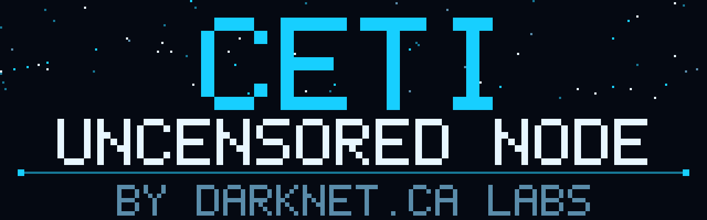
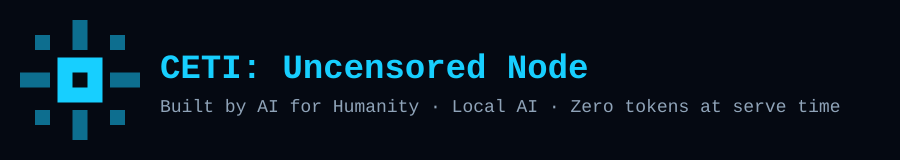
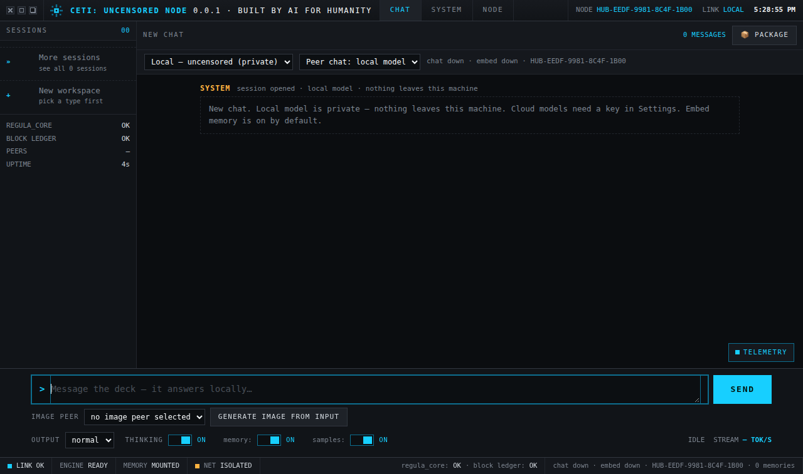
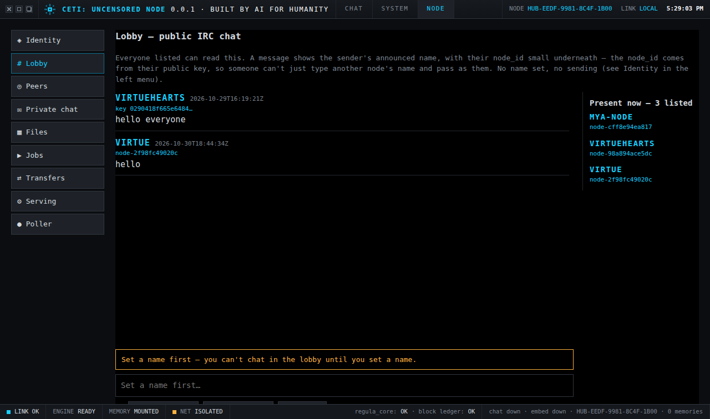
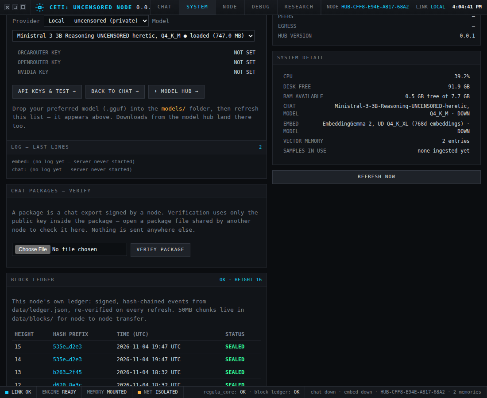

# CETI: Uncensored Node — your machine, your data, your mind

**Built by [darknet.ca labs](https://darknet.ca) — Jero (drkkrobot, aka [Virtuehearts](https://github.com/virtuehearts)), Toronto, Canada. darknet.ca has been around since 2002.**

```
===============================================
  CETI — Zero tokens. A new type of brain.
  Your machine. Your data. Your mind.
===============================================
```

CETI is a new type of brain: a local brain that answers from what
it knows, instead of a model guessing in the moment. The model is
the night shift — it researches, distills, and promotes while you
sleep. Serving is pure retrieval. Teach it once and the next ask
costs nothing, because the answer already lives on the box. No
tokens. No per-question bill. No account.

This is not a chatbot you rent by the token. It is a BIOS for AI:
a small layer that asks every local store at once — AIML cassettes,
the fact store, vector memory, your library, signed datasets — and
compiles the answer from what they hold. The model is a peripheral,
not the brain.

And the brain is not alone. Every node is a peer: it holds its own
sovereign knowledge, answers its own questions, and shares signed
facts with the nodes it trusts. Knowledge travels node to node,
verified by signature, never by a platform. The network is the sum
of its nodes, not a server in someone else's building. CETI on many
boxes is a networked knowledge infrastructure with no centre —
meant to rival WikiLeaks and Wikipedia, and built to not need them.
It feels like Gopher — retro but super useful: every peer is a
public key.

Chat, CETI sessions, long-form stories and ezines, code, voice,
and image — served by uncensored models you control, shared node
to node.

If you want your AI to live in your own building, this is the
project. Welcome to the network.

## Sovereignty, in two parts

- **Data sovereignty.** Your data stays on your machine, in stores
  you can read, sign, and carry. Nothing leaves the building unless
  it has to — personal data is stripped before anything touches the
  cloud, and the cloud only ever sees the gap, never your whole
  store.
- **Intelligence sovereignty.** Your intelligence stays yours. Your
  personality, your memory, your judgement — they live in your local
  stores, not in someone else's model. No one else's model shapes
  your answers.

That is what sovereign knowledge means: the copy on your iron is
yours, the provenance is checkable, and nobody can rewrite it,
delist it, or bill you per question for it.

Find us on X: the original handle is
[@darknet_ca](https://x.com/darknet_ca) (since 2008); the new one is
[@virtue_hearts](https://x.com/virtue_hearts).

## Run it in 2 minutes

That's it — no installs to babysit, no accounts to create.

1. Install the newest Python from
   [python.org](https://www.python.org/downloads/).
2. Download [`laptop-uncensored-node-0.0.1-beta4.zip`](https://drive.google.com/uc?id=1iuYwK6cH3cUQM65Sj5T0JiD-2-qt14TL&export=download) (47 MB) and unzip it.
3. Run `autorun.bat` (Windows) or `autorun.sh` (Linux). It checks
   the setup, downloads the models, starts the servers, and opens
   the web UI.
4. Open `http://localhost:8900` in your browser.

Then join the network: in the Node tab, set a node name and press
**Announce** — your node lists immediately with the capabilities it
claims. To use another node's text, voice, or image, send your
pubkey to that node's operator (Lobby, sysop chat, or
admin@darknet.ca) and ask to be allow-listed. A job only runs if
the serving node has your pubkey on its allow-list.

Primary testing is done on **Windows, with a 6 GB RTX card** (an
RTX 3060 laptop) — chat on VRAM, embeddings on CPU/RAM by default
so they don't steal VRAM. A model needs disk space and RAM/VRAM to
run; GPU memory figures in the Models tab are labelled estimates
(file size × 1.2), not measurements.

## What you get

- **Chat** — everyday talk with a local uncensored model, or a
  cloud model when you pick one. Your keys live in your browser
  only; the server never writes them to disk.
- **CETI sessions** — answers from the CETI ladder: facts, AIML,
  and local knowledge first, cloud only as a suggestion. CETI's
  design goal is zero tokens at serve time: the model is a
  background compiler, and serving is pure retrieval. Every
  answer shows its tier, its reasoning, and its signed ledger
  entry.
- **Node network (Gopher, not a platform)** — announce your node
  and it lists immediately with the capabilities it claims. No
  approval, no verified flag, no network sysop. Allow, deny, and
  mute live per node, and every answer is signed by the node's own
  key.
- **Lobby** — a public IRC-like room for listed nodes, plus
  private sysop chat and file transfers between nodes.
- **Research tab** — a local agent with a heartbeat. It compiles
  what CETI already knows, reads source pages as text, distills
  what it learns, and proposes it for your approval. Approvals are
  what move the ladder — and the benchmark score.
- **Models tab (the model hub)** — browse Hugging Face
  collections (default: `chwoo/uncensored-models`) and download
  GGUFs into `models/`. Drop your preferred model (`.gguf`) into
  `models/` yourself and it appears in the System tab's local
  model list — pick it there to load it.
- **SSH terminal** — a terminal in the workspace. It defaults to
  **chat.hf.co**, where you can use free models by pairing your
  Hugging Face account.
- **Memory** — a node view of vector memory, with provenance on
  every reply: which memories were used, and what drew on them.

## Models & cloud API

Local chat is the default and sends nothing anywhere. When you pick
a cloud provider in Chat, the key stays in your browser
(localStorage) and rides along with each request.

Providers, in list order:

- **Local — uncensored (private).** The GGUFs in `models/`,
  picked in System → Models & cloud API. The loaded one is marked.
- **OrcaRouter** — `https://api.orcarouter.ai/v1`
  (OpenAI-compatible). Keys look like `sk-orca-…`
  (`ORCAROUTER_API_KEY`). `orcarouter/auto` is seeded on signup
  and picks the cheapest live chat model; the model list is
  public, so the dropdown populates before you add a key.
- **OpenRouter** — `https://openrouter.ai/api/v1`. Free models
  list first.
- **Nvidia** — `https://integrate.api.nvidia.com/v1`.

Node endpoints (same OpenAI-compatible shape for all three):

- `GET /api/cloud/models?provider=orcarouter|openrouter|nvidia`
  (key in the `X-API-Key` header; without a key the provider's
  suggestion list is returned)
- `POST /api/cloud/test` — `{provider, api_key, model}` tests one
  model and reports back
- `POST /api/chat` — `{messages, provider, model, api_key?}`
  streams the reply

## Screenshots

Project logo:



Chat, the default view:



Node tab, Lobby — the IRC room:



System tab — local model picked, RAM available:



## The ledger (regula core)

The ledger is the filesystem. Every write a node makes is a signed,
hash-chained ledger event — sessions, code, stories, samples, model
downloads. Every CETI answer, session save, and share is appended
to the node's own signed ledger (`regula_core: OK`, `block ledger: OK`
in the footer). Shared files publish as signed Merkle bundles, and a
failed publish records no ledger event: rejected items never enter
signed history. Verification uses only the keys inside the
package — nothing is sent anywhere else to check it.

## A note on CETI

CETI is the front end to sovereign knowledge: own the machine, own
the data, own the mind. It is a BIOS for AI — the small layer that
boots a machine into a sovereign peer-to-peer compute node, asks
every local store at once, and compiles the answer from what they
hold. The model is a peripheral, not the brain.

The full CETI BIOS for general intelligence is still ahead. This
release does not use CETI AIML technology yet. CETI
technology was used in developing this release, and the node network
is the platform the new CETI is built on. The Brain pane shows CETI
components as a read-only view; the packaged release runs the node
network, the ledger, and the model serving described above.

## Hardware sponsors wanted

We are **actively looking for hardware sponsors**. If you can
donate GPUs, machines, or hosting to keep uncensored nodes
running, email **admin@darknet.ca** — tell us what you run and
what you want to serve, and we'll get you listed and set up.
Anyone who wants to join the project gets a **free darknet.ca
Gmail account** — same address to ask.

## Status

- **Version:** 0.0.1-beta4. (Beta4 follows beta3 the same morning,
  2026-11-15: the all-layers-reason redesign below.)
- **Tests:** 619 checks green at this build (unit 331: Hub 124,
  Brain 6, CETI 33, SSH terminal 37, Research 42, Sessions 5,
  Local models 8, Code agent 9, Workspace 6, TTS bundle 11,
  Toggle reasoning 6, Llama install 14, Llama gate 9,
  TTS control 20; script suites 288:
  nodeapi 101, community 16, image 13, node_client 12,
  text_handler 8, transfer 13, transfers/serving 14, tunnel 19,
  two_nodes 36, edge_cases 35, presence 21).
- **New in 0.0.1-beta4:** **All layers reason — the local model
  constructs every answer.** No layer returns its hit directly
  any more. Every tier outputs what it found — math result
  (computed in Python, never by the model), facts, AIML templates,
  lexicon definitions, vector memories — and the local model
  builds the answer from all of it, every time, under the
  grounded-only prompt with the numbers guard. "What is the
  currency of Japan?" now answers as a constructed sentence
  ("Japan's currency is the Japanese Yen, code JPY") instead of
  the bare fact line, and "17 * 23 + 41" comes back as "According
  to the local math computation provided, 17 × 23 + 41 = 432".
  Tier 1b arbitration and Tier 1c elaboration are gone — the
  construct call does both, for every question. Deliberately
  unchanged: when the model is down, the best direct hit answers
  instead of failing the question; when there is no local context
  at all, the model is still never called (the cloud suggestion
  stands); ungrounded answers are never written into vector
  memory. Verified live on the Hub. The trade-off Jero chose:
  every question now costs one model call (about 26–28s on the
  small CPU model; much faster on a GPU model), so the old
  zero-model-tokens-at-serve-time goal gives way to this.
- **New in 0.0.1-beta3:** **CETI Tier 5b — the loaded model
  answers when local knowledge has no hit.** "Please tell me the
  best way to setup a bbs" used to come back "I don't know from
  local knowledge." — even though the local model was called and
  was UP. The grounded Tier 5 prompt forbids the model from
  answering from its own weights when the assembled context
  (lexicon + AIML + vector memory) does not contain the answer.
  Now, when the grounded call returns that exact refusal, the
  loaded model is asked again from its own knowledge and the
  answer is labelled **local-model-ungrounded** in the tier and
  evidence, with numbers ungrounded, so it is never passed off
  as grounded local knowledge. Verified live: the BBS question
  answers (188s for the two calls on a small CPU model; much
  faster on a GPU model). Deliberately unchanged: when there is
  no local context at all, the model is still never called (the
  cloud suggestion stands); ungrounded answers are never written
  into vector memory, so model output can never become local
  knowledge; and an arbitration refusal now falls through to the
  lower tiers instead of ending the ladder. Grounded answers,
  precise questions, and the zero-token direct tiers are
  untouched.
- **New in 0.0.1-beta2:** (1) **SSH fixed on Windows.** ConPTY
  was the default from 0.0.1u through beta and never delivered a
  byte on the laptop — every run was a live pid with empty pipes
  ("no output yet"), even after the 0.0.1v alignment with
  Microsoft's sample — while the pipe session rendered the HF
  TUI in the 0.0.1r–t era. The Windows default is the pipe
  session again, and ConPTY is an opt-in checkbox in the SSH
  pane ("ConPTY (experimental)") for the operator who has passed
  `tools\conpty_selftest.py`, which now also has `ssh` and
  `ssh-pipe` modes that test the real ssh argv to chat.hf.co.
  The status line now polls every 2s and says why a session
  died: a session that ends with no output names its exit code
  (255 = ssh failing at the network/auth layer; a live pid with
  zero bytes = the PTY never delivering). Also fixed: the status
  line showed a bare "0.0.1" for the whole beta line because the
  build regex stopped at the hyphen in "0.0.1-beta". (2) **README
  rewritten to the CETI public story** (ceti.darknet.ca): local-
  first, peer-to-peer, local-blockchain-ledger AI; data
  sovereignty and intelligence sovereignty; darknet.ca since
  2002; @darknet_ca (since 2008) and @virtue_hearts.
- **New in 0.0.1-beta:** (1) **CETI elaboration (Tier 1c).** A
  clear fact hit used to return the bare fact verbatim even when
  the sysop asked for more — "tell me more about fidonet" came
  back as one line and the local model never saw the hit. Now an
  explicit ask for more ("tell me more", "explain", "tell me
  about", ...) feeds every matched fact plus the related AIML
  templates to local LFM3, which composes the fuller answer from
  local knowledge only (numbers guard still applies). Live:
  "tell me more about fidonet" elaborates in ~26s; a precise
  question ("when did FidoNet start operating?", "currency of
  Japan?") still returns the bare fact in ~0.2s with zero model
  tokens. Model down or nothing more to add falls back to the
  direct fact — elaboration never fails the question. (2)
  **Packaged TTS fixed.** Nothing in `tts/` changed between
  0.0.1k and 0.0.1n — the breakage was in the paths around it.
  The Hub's START button launched `start_tts.bat` directly,
  which Windows refuses (a .bat is not an executable: WinError
  193), so on the laptop START silently did nothing while the UI
  said "Starting…"; it now goes through `cmd /c`, the same as
  autorun. Dependencies are pinned in `tts/requirements.txt` to
  the versions verified with this bridge (torch 2.14.0+cpu,
  pocket-tts 3.2.0, scipy 1.18.1) instead of floating to newest.
  Both start scripts now fail loudly with a log line instead of
  dying silently, and the System view shows STARTING only while
  a start is really running plus the last bridge-log lines when
  TTS is down, so a failed first-run install no longer looks
  like "still building". Verified: the packaged bridge boots and
  synthesizes mya-03 (3.1s of audio for one sentence). One honest
  limit stands: a prebuilt venv cannot ship inside the zip
  (torch alone is ~1 GB and platform-specific), so the first run
  on a fresh extract still builds the venv and downloads the
  model — now pinned, checked, and visible.
- **New in 0.0.1n:** (1) **Night-shift research bundle.** 67 verified
  facts + 38 QA across 13 topics (Ethereum, Bitcoin, secp256k1, Gopher,
  Tor, IPFS, llama.cpp, Rust, WireGuard, Cloudflare Workers, darknet.ca
  dates, Darknet Diaries, Jack Rhysider), plus 183 Darknet Diaries
  episode facts pulled from the RSS feed — all checked against live
  sources. 107 proposals were left pending and are not in the bundle.
  (2) **Modem research bundle.** 49 facts + 52 QA across 7 topics
  (2400 baud BBS era, V.32bis 14.4k, V.34 28.8k/33.6k, the 56k
  standards war, Hayes AT, USR Sportster/Courier, the dial-up
  timeline), verified against the ITU text, Wikipedia, and original
  press releases; one drifted FidoNet fact was quarantined and is
  not in the bundle. Both bundles ship as facts + AIML in
  brain/cassettes/ and load at startup, so CETI answers modem and
  night-shift questions from local knowledge, zero model tokens.
  (3) **Test expectations updated for the new knowledge.** The
  packaged-seed module count goes 31 to 33 (the two new cassettes),
  and the FidoNet AIML top-four now leads with the modem bundle's
  verified FidoNet category. (4) **jero_worker_mips descriptor.**
  The simulated Cobalt Qube node's public descriptor ships in
  brain/nodes/ (pubkey only, no secret); the node itself is not
  announced.
- **New in 0.0.1l:** (1) **CETI arbitration (Tier 1b).** When
  several facts or AIML patterns match a question, the local
  model now arbitrates over all of them instead of the ladder
  taking the first. A single clear fact or pattern still returns
  directly (fast, zero model tokens). Only genuine ambiguity —
  several facts sharing a predicate, no predicate word with
  several subject matches, or several AIML patterns — feeds the
  candidates to local LFM3 (thinking off, short answer budget)
  to pick or combine the best answer from local knowledge only.
  Live: "Tell me about Japan" composed 8 facts into one answer
  in 14–20s; a clear fact ("currency of Japan") still answers in
  0.1s with no model call. If the model is down or answers
  empty, the ladder falls through to the lower tiers instead of
  failing the question. (2) **Test-isolation fix.** One test
  module set HUB_DATA_DIR at import and clobbered another's
  database under `discover`; the attachment tests now pin and
  restore it, so the full suite is green in any import order.
- **New in 0.0.1k:** (1) **TTS server in System.** The Servers
  card gains a TTS SERVER row (Start/Stop, status from the
  bridge's /health) under the node poller, and a voice panel
  below Refresh servers: the voices the bridge knows (read from
  its voices.db, built-ins mya-02/mya-03 when the DB is missing),
  a test line spoken in the selected voice (real MP3, waveform
  player), and Set as default (writes only tts_voice, so it
  cannot clobber the serving backend/model). The bridge start
  records its PID (autorun writes it at boot too), so Stop works
  on the boot-started bridge. (2) **llama-server auto-install
  fix** (from 0.0.1j, now in this build): Linux packages are
  `.tar.gz`, not `.zip`, and the version prints to stderr.
- **New in 0.0.1j:** (1) **llama-server auto-install fixed for
  Linux/WSL.** The installer failed on the laptop with "could not
  discover a llama.cpp release asset" because llama.cpp switched
  its Linux packages from `.zip` to `.tar.gz` and the picker only
  accepted `.zip` — every Linux asset was silently rejected. The
  picker now accepts `.tar.gz` (and `.tgz`, and `.zip` for older
  releases), the installer extracts tarballs, and it flattens the
  `llama-bXXXX/` subfolder the tarball extracts to (binary + its
  `.so` libs land in `bin/` together, since the binary's RUNPATH
  is `$ORIGIN`). The plain CPU build (`llama-*-bin-ubuntu-x64.tar.gz`,
  no 'cpu' in the name) now matches the CPU fallback instead of
  being skipped. (2) **Version read from stderr.** `llama-server
  --version` prints to stderr, not stdout; the build check only
  read stdout, so it reported 'unknown build' and the fail-closed
  gate skipped a perfectly good binary even after a successful
  download. Both streams are now read. Verified end to end: real
  download of the current Vulkan build (b12192), installs, reports
  build 12192, and `find_server()` finds it.
- **New in 0.0.1i:** (1) **Presence.** The list host is now a
  live roster, not a permanent one: each announce stamps a server
  `seen` time and GET /nodes only returns nodes seen within 15
  min. The poller heartbeats by re-announcing every 5 min, so a
  live node stays listed and a dead one drops off within 15
  minutes. Nodes are sharded (one `node:<pubkey>` key each) so an
  announce never rewrites the whole list. The Worker ships as
  `worker-node-list.js` + `wrangler.toml` for a separate deploy —
  it is NOT deployed in this zip. (2) **Rate limiting.** Each
  send counts against its sender's quota: 600 per 10 min, 429
  over it, keyed by the verified pubkey. Polls are not
  rate-limited (an empty poll writes nothing). (3) **15s poll
  for testing.** The poll interval is 15s on this box during
  testing for snappier jobs; the shipped default stays 60s.
  (4) **Fail loud.** An unknown capability now gets an error
  reply (`capability 'X' not offered by this node`) instead of a
  silent skip, so the sender's UI can show why there is no
  answer. (5) **New node test suites.** Two-node scenarios (36),
  edge cases (35), and presence/rate-limit (21) now ship in
  `tests/` with the plan in `TEST-PLAN.md`.
- **New in 0.0.1h:** (1) **Reasoning budget 512.** The local LFM3
  server now runs `-c 4096 --reasoning-budget 512` instead of
  `--reasoning off`: unrestricted thinking traps the model (0
  content, 13,190 chars reasoning), reasoning off fixes the empty
  output but the distill drifts, and a 512-token budget is the
  sweet spot (Nobel distill probe: 2,811 chars, 8 QA + 8 facts,
  first QA naming all three 2024 winners). The reasoning budget
  counts towards max_tokens, so callers size it as budget +
  answer: the research distill uses 512 + 1500 = 2012, and the
  chat fit-budget adds the 512 thinking room on top of the user's
  answer budget. (2) **Focused local report.** The local distill
  now leads with the topic's table rows plus a short lead of
  topic sentences only (339 chars for Nobel) — the full 2000-char
  report drifted off-topic (16 proposals, 0 about 2024); the
  combined fix gives 11 proposals, all about 2024, all three
  winners present. Cloud distill is unchanged. (3) **The Thinking
  toggle works.** It used to only hide the thinking panel; it now
  sends `thinking` to `/api/chat` and the local model honours it
  per request (`chat_template_kwargs enable_thinking=false`,
  proven: reasoning ON 0 content/349 reasoning chars, OFF 288
  content/0 reasoning). For cloud reasoning models (Nvidia
  lightning-30b-a3b, nano-30b-a3b) the toggle is greyed out with
  "Reasoning cannot be turned off for this model"; bolt-e4b and
  local are not greyed out.
- **New in 0.0.1g:** (1) **Bundled Mya TTS.** The PocketTTS bridge
  now ships inside the release as `tts/` — the bridge code, the
  mya-02 and mya-03 voices (samples + embeddings), a fresh
  voices.db, and `start_tts.sh` / `start_tts.bat`. The autorun
  starts it alongside the Hub (fail-soft: a missing tts/ folder or
  a failed start never blocks chat). The kyutai/pocket-tts model
  (~215M) is not shipped — it downloads from Hugging Face on first
  run, same rule as the Hub's models. Proven live: the bundled
  copy answered /health with model ready and synthesized a
  25,101-byte MP3 in the mya-03 voice. (2) **Local distill —
  context limits tested and refuted.** Raising the local context
  (8192) and the output budget (3000 tokens) does NOT fix the
  local distill: the model still returned empty content and burned
  the whole budget thinking (13,190 chars of reasoning); a
  plain-text (non-JSON) prompt did the same (0 content, 2,200
  chars reasoning). The limits were not raised — they would only
  waste more time. Cloud remains the working distill path when a
  key is configured.
- **New in 0.0.1f:** (1) **Attachments.** A paperclip in the chat
  composer attaches files into the session's context: text and PDF
  files are chunked, embedded, and retrieved by the same vector
  bar as memories; images are stored and shown. Proven live — the
  local model answered a question from an attached manual with the
  exact detail. (2) **Expandable code box.** Long ``` code blocks
  render collapsed (~170px) with language, copy, and expand, in
  chat and in attachment rendering. (3) **Research mode.** When
  CETI can't answer, a "Suggest research job" button queues a web
  job (Wikipedia API first, Google second); the agent fetches the
  pages, distills QA pairs + fact triples, and lands them as
  pending proposals for a human to approve — nothing auto-promotes.
  Fixes since the first cut: the report cap, zombie-claim, the
  tick loop, Wikipedia nav stripping, wikitext table-row extraction
  (answers that live in tables), and cloud-first distill with a
  12000-char report. (4) **Cloud context lifted.** Cloud chat now
  injects session files with a 30000-char budget (local keeps 3000
  for its 2048-token context); the long-term vector memory stays
  local-only and never goes to a cloud provider. (5) **Known
  limit:** the local model returns empty content for the JSON
  distill prompt (it burns its whole output budget thinking), so
  cloud is the working distill path when a key is configured.
- **New in 0.0.1e:** (1) **Session chips are back on phones.**
  The 0.0.1c chat-first pass hid them behind the More-sessions
  drawer; they show again as a sideways-scrolling strip of the 3
  most recent sessions (More sessions opens the drawer for the
  rest, same as desktop), chat still 80% of a 412×915 screen.
  (2) **Generated voices persist.** A voice used to live only in
  the page and vanished when you left the session or reloaded.
  New `POST /api/chat-voice/save` + `GET /api/chat-voice/<name>`
  store the MP3 on the server (`data/chat-voice/`, MP3 only,
  20MB cap) and the filename rides on the message, so the
  waveform player comes back after a session switch or a reload
  — verified at 412×915: 322,605-byte MP3, waveform drawn, Play
  works, Save links to the stored file. (3) **Mobile-size audit:**
  the viewport tag is correct and one 720px breakpoint decides
  the layout — phones get the mobile UI, desktop resolutions get
  the sidebar UI (verified at 360/412/710/721/768/1024/1280/
  1920, no overflow). Two bugs found by the audit and fixed: at
  360px wide the SEND button was pushed off-screen (the input
  couldn't shrink — fixed with `min-width:0` on the input wrap),
  and the Node tab used a different breakpoint (700px) than chat
  (720px) — aligned to 720px, so mobile means one width
  everywhere. (4) Nothing else changed since 0.0.1d: the fresh-
  browser voice-peer default, the TTS voice fix, the chat-first
  mobile UI, the Nvidia custom-model input and working-model
  fallback, and the digit-guarded `x` → `*` math fix all carry
  over.

- **Offline copy:** this README, with images baked in, ships at
  `info/ceti-readme-baked.html` — open it anywhere, no network
  needed.

Own the machine, own the data, own the mind. Sovereign AI, from Canada, on your own iron. Welcome to the network.
